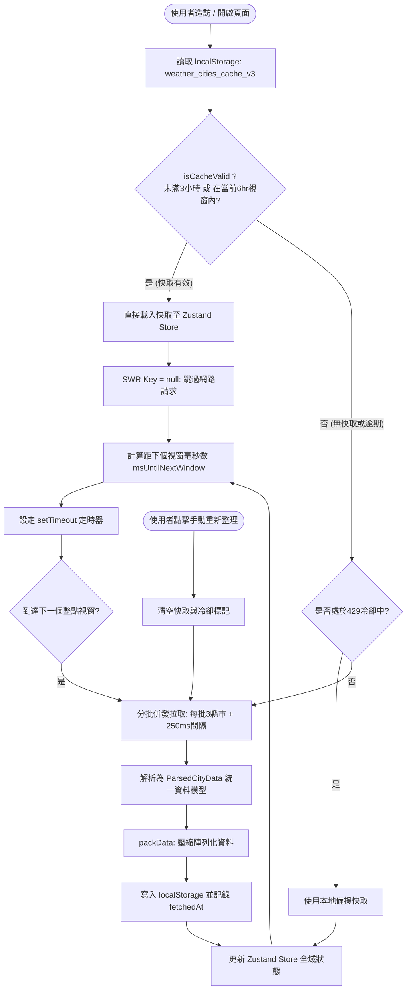
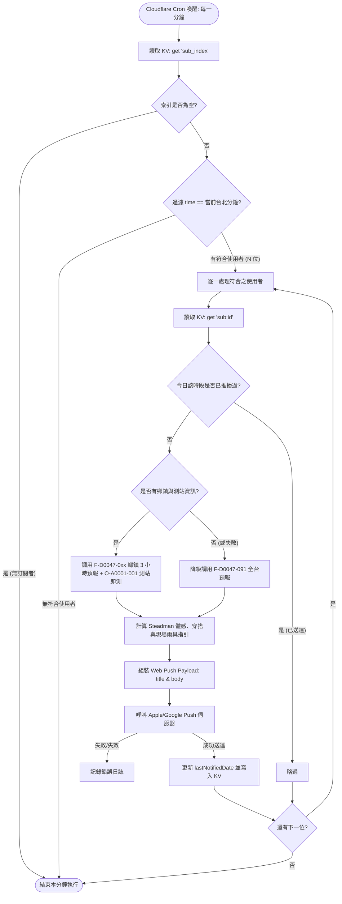

# 台灣天氣預報系統 - API 呼叫制度、快取機制與資料結構完整規範文件

本文件詳細說明本專案與中央氣象署（CWA）Open API 對接的呼叫制度、週期頻率、快取判斷機制、分批併發流控以及前後端統一資料結構。

---

## 壹、API 呼叫制度與頻率監察報告

### 1. 現行呼叫頻率與觸發制度

本專案採用 **「6 小時時間視窗制度（6-Hour Window Scheduling）」配合「3 小時保證保鮮期」**，對齊中央氣象署每日 4 次主要預報更新節點：

* **時間視窗起點（UTC+8）**：`00:00`、`06:00`、`12:00`、`18:00`。
* **視窗週期跨度**：每 **6 小時**（360 分鐘）為一個獨立的預報視窗。
* **3 小時絕對保鮮期 (`MIN_FRESH_HOURS = 3`)**：無論何時進入，若上次抓取時間距今未滿 180 分鐘，系統保證直接讀取 Storage 暫存，發送 **0 個 API 請求**。

```text
┌───────────┬───────────┬───────────┬───────────┐
│ 00:00視窗 │ 06:00視窗 │ 12:00視窗 │ 18:00視窗 │
└───────────┴───────────┴───────────┴───────────┘
```

#### 自動輪詢／排程觸發機制 (`msUntilNextWindow`)
系統精確計算當前時間距離下一個 6 小時整點起點的毫秒數：
$$\Delta t = \text{NextWindowStart} - \text{CurrentTime}$$
* 範例：若使用者在 14:20 打開網頁，距離下一個視窗起點（18:00）尚有 3 小時 40 分鐘。系統會透過 `setTimeout` 設定在 18:00:00 自動喚醒並發出 `mutate()` 重新拉取新預報。
* 重新拉取完成後，立即遞迴預約下一次視窗的排程，達成真正的低耗能定時同步。

---

### 2. 快取優先檢查機制 (`Cache-First`)

為了防止使用者頻繁刷新頁面或切換元件導致 API 額度超載，系統結合了 **`localStorage` 本地壓縮儲存** 與 **SWR 資料請求快取**：

1. **檢查快取有效性 (`isCacheValid`)**：
   * 檢查本地鍵值 `weather_cities_cache_v3`。
   * 比對快取資料中的 `fetchedAt`（抓取時間戳記）：
     * **條件一（絕對保鮮）**：$\text{CurrentTime} - \text{fetchedAt} < 3\text{ 小時}$ $\rightarrow$ 直接判定有效。
     * **條件二（視窗對齊）**：$\text{WindowStart} \le \text{fetchedAt} < \text{WindowEnd}$ $\rightarrow$ 判定有效。
     * 只有當「既超過 3 小時，又已跨入下一個 6hr 視窗」時，才判定過期。
2. **快取有效時（命中 Cache）**：
   * `getSWRKey()` 回傳 `null`。
   * **完全跳過任何網路 Request，發送 0 個 API 請求**。
   * 直接將快取資料灌入 Zustand 全域 Store，實現「零延遲、首屏秒開」。
3. **快取無效／過期／初次造訪時**：
   * `getSWRKey()` 啟用 `'ALL_CITIES_WEATHER_DATA'`。
   * 觸發網路請求發送，獲取成功後自動壓縮寫入 `localStorage`，記錄最新的 `fetchedAt`。

---

### 3. 分批拉取架構與防 429 限流機制 (`Batch Fetching`)

* **呼叫來源**：交通部中央氣象署開放資料平台（CWA OpenData API）。
* **資料集代碼**：
  * **全台 870+ 自動氣象站即測現況**：`O-A0001-001`（單一輕量請求，拉取全台測站即時溫度、風向、風速，保留小數點 1 位，耗時僅約 180ms）。
  * 全台 22 縣市鄉鎮 3 天逐 3 小時預報：`F-D0047-001` ～ `F-D0047-085`。
  * 全台未來 1 週逐 12 小時預報：`F-D0047-091`（單一輕量請求）。
* **即測實況與數值預報模型的分流機制**：
  * **即測資料 (`O-A0001-001`)**：進入首頁或手動點擊「重新整理」時即時調用，無須等待預報快取過期，確保呈現最新站點現況。
  * **逐 3 小時預報模型 (`F-D0047`)**：維持嚴格的 3~6 小時快取保護，非必要不重發 22 支縣市請求。
* **分批並發控制 (Batch Size = 3)**：
  為避免一次同時發送 22 支 API 觸發氣象署 WAF 429 拒絕服務，系統改採每批 3 支併發，批次間微間隔 250ms：
  ```ts
  const BATCH_SIZE = 3;
  for (let i = 0; i < CITIES.length; i += BATCH_SIZE) {
    const batch = CITIES.slice(i, i + BATCH_SIZE);
    const batchPromises = batch.map((city) => fetchCity(city));
    await Promise.all(batchPromises);
    if (i + BATCH_SIZE < CITIES.length) {
      await new Promise((resolve) => setTimeout(resolve, 250));
    }
  }
  ```
* **429 降級保護與冷卻機制**：
  * 若偵測到 429 限流，自動啟動 5 分鐘冷卻保護 (`setRateLimitCooldown(5)`)。
  * 冷卻期內或請求失敗時，自動降級使用現有的本地快取資料，確保使用者介面不崩潰。

---

### 4. SWR 防重複與去重保護

* `revalidateOnFocus: false`：切換瀏覽器分頁或視窗切回時，不重新請求。
* `revalidateOnReconnect: false`：斷線重連時，不立即重發，避免重連震盪。
* `dedupingInterval: 60000`（60 秒）：1 分鐘內如果有多個元件同時觸發 mutate，強制去重合併為單次請求。

---

### 5. 手動強制更新機制 (`Manual Refresh`)

* **防刷間隔保護**：手動更新具備冷卻計時保護（預設 10 分鐘內按鈕顯示冷卻中，避免暴力連點）。
* 使用者點擊「重新整理」按鈕時：
  1. 呼叫 `clearCache()` 與 `clearRateLimitCooldown()`。
  2. 呼叫 SWR 的 `refetch()` (`mutate()`)。
  3. 平滑分批重新向中央氣象署請求全台資料並刷新全站狀態。

---

## 貳、API 呼叫與快取決策流程圖



---

## 參、系統資料結構規範 (Data Structure Schema)

### 1. 中央氣象署 (CWA) 原始 API 回傳結構

```ts
// 氣象署單一時段因子值
export interface TimeEntry {
  DataTime?: string;                          // 觀測/預報時間點 (ISO 字串)
  StartTime?: string;                         // 預報時段起點
  EndTime?: string;                           // 預報時段終點
  ElementValue: Record<string, string>[];     // 具體數值物件陣列，如 [{ Temperature: "28" }]
}

// 氣象署天氣因子物件
export interface WeatherElement {
  ElementName: string;                        // 因子名稱: 天氣現象 / 溫度 / 相對濕度 / 舒適度指數 / 風向 / 風速 / 3小時降雨機率 等
  Time: TimeEntry[];                          // 時段資料清單
}

// 鄉鎮行政區物件
export interface Location {
  LocationName: string;                       // 鄉鎮市區名稱，如「中正區」、「板橋區」
  Geocode: string;                            // 地理代碼
  Latitude: string;                           // 緯度
  Longitude: string;                          // 經度
  WeatherElement: WeatherElement[];           // 該鄉鎮包含的所有氣象因子
}

// 縣市資料集容器
export interface Locations {
  DatasetDescription: string;                 // 資料集描述
  LocationsName: string;                      // 縣市名稱，如「臺北市」
  Dataid: string;                             // 資料集代碼，如「D0047-061」
  Location: Location[];                       // 該縣市轄下所有鄉鎮陣列
}

// CWA 頂層 API 回應包裝
export interface ApiResponse {
  success: string;                            // "true"
  result: {
    resource_id: string;
    fields: { id: string; type: string }[];
  };
  records: {
    Locations: Locations[];
  };
}
```

---

### 2. 前端解析後的正規化資料模型 (Normalized Domain Model)

#### (1) `WeatherPeriod`（單一 3 小時預報核心結構）
將氣象署深層嵌套的 `WeatherElement` 解析展平成平鋪物件：

```ts
export interface WeatherPeriod {
  startTime: string;                  // 時段起點 (YYYY-MM-DDTHH:mm:ss+08:00)
  endTime: string;                    // 時段終點 (YYYY-MM-DDTHH:mm:ss+08:00)
  
  // ── 溫度指標 ──
  temperature: string;                // 實測/預估平均氣溫 (°C)
  maxTemperature: string;             // 最高氣溫 (°C)
  minTemperature: string;             // 最低氣溫 (°C)
  maxApparentTemperature: string;     // 最高體感溫度 (°C)
  minApparentTemperature: string;     // 最低體感溫度 (°C)
  
  // ── 水氣與濕度 ──
  relativeHumidity: string;           // 相對濕度 (%)
  dewPoint: string;                   // 露點溫度 (°C)
  probabilityOfPrecipitation: string; // 3 小時降雨機率 (%)
  
  // ── 舒適度 ──
  maxComfortIndex: string;            // 舒適度指數數值
  maxComfortIndexDescription: string; // 舒適度描述 (舒適 / 偏涼 / 悶熱 / 寒冷)
  minComfortIndex: string;            // 最低舒適度指數
  minComfortIndexDescription: string; // 最低舒適度描述
  
  // ── 風況 ──
  windDirection: string;              // 風向 (如「東北風」、「偏南風」)
  windSpeed: string;                  // 平均風速 (m/s)
  beaufortScale: string;              // 蒲福風級 (0~12 級)
  
  // ── 天氣現象 ──
  weather: string;                    // 天氣名稱 (晴時多雲 / 短暫陣雨 等)
  weatherCode: string;                // 氣象署天氣代碼 -> 對應 Meteocons SVG 動態圖示
  weatherDescription: string;         // 天氣預報綜合描述文字
  
  // ── 紫外線 ──
  uvIndex: string;                    // 紫外線指數 (0~12)
  uvExposureLevel: string;            // 紫外線等級 (低量級 / 中量級 / 高量級 / 過量級 / 危險級)
}
```

#### (2) `WeeklyForecastDay`（未來 7 天一週預報結構）
```ts
export interface WeeklyForecastDay {
  dateStr: string;                    // 日期字串 (YYYY-MM-DD)
  dayLabel?: string;                  // 星期幾 (如「週一」)
  minTemp: number;                    // 當日最低溫
  maxTemp: number;                    // 當日最高溫
  maxPop: number;                     // 當日最高降雨機率
  weather: string;                    // 天氣現象
  weatherCode: string;                // 天氣代碼
  description: string;                // 預報描述
  startTime: string;                  // 代表時段起點
}
```

#### (3) `ParsedTownshipData` & `ParsedCityData`
```ts
export interface ParsedTownshipData {
  townshipName: string;               // 鄉鎮市區名稱 (如「新店區」)
  geocode: string;                    // 地理編碼
  latitude: string;                   // 緯度座標
  longitude: string;                  // 經度座標
  periods: WeatherPeriod[];           // 未來 3 天逐 3 小時預報陣列 (約 24 個時段)
}

export interface ParsedCityData {
  cityName: string;                   // 縣市名稱 (如「新北市」)
  datasetId: string;                  // 氣象署資料代碼 (如「F-D0047-069」)
  townships: ParsedTownshipData[];    // 轄下鄉鎮區清單
}
```

#### (4) `RealtimeWindData`（即測風向與風速模型）
```ts
export interface RealtimeWindData {
  windSpeed: string;         // e.g. "4.9" (保留 1 位小數，拒絕四捨五入)
  windDirection: string;     // e.g. "北北東風"
  windCardinal: string;      // e.g. "北北東"
  windDegree: number;        // e.g. 22 (真實角度度數，供羅盤平滑旋轉)
  beaufortScale: string;     // e.g. "3" (蒲福風級)
  stationName?: string;      // e.g. "大武崙" (生活代表測站名稱)
}
```

#### (5) `CachedData`（本地快取與壓縮儲存）
```ts
export interface CachedData {
  fetchedAt: string;                                     // 資料拉取時的 ISO 8601 時間字串
  cities: ParsedCityData[];                              // 全台 22 縣市完整預報資料
  weeklyForecasts?: Record<string, WeeklyForecastDay[]>; // 未來 7 天各縣市預報
  realtimeTemps?: Record<string, string>;                // 鄉鎮即時實測氣溫 (如 "24.8")
  realtimeWinds?: Record<string, RealtimeWindData>;      // 鄉鎮即時實測風況資料
}
```
*註：寫入 LocalStorage 前會由 `packData()` 將 `WeatherPeriod` 與 `realtimeWinds` 轉換為壓縮欄位結構，使整體龐大資料穩定控制在 1.4MB 以內。*

---

### 3. Zustand 全域狀態結構 (`weatherStore`)

```ts
export interface WeatherState {
  // 資料集
  cities: ParsedCityData[];
  setCities: (data: ParsedCityData[]) => void;
  weeklyForecasts: Record<string, WeeklyForecastDay[]>;
  setWeeklyForecasts: (forecasts: Record<string, WeeklyForecastDay[]>) => void;
  
  // 當前選取縣市與鄉鎮
  selectedCity: string;               // 預設 '臺北市'
  setSelectedCity: (cityName: string) => void;
  selectedTownship: string;           // 預設 '' (自動選取該縣市第 1 個鄉鎮)
  setSelectedTownship: (townshipName: string) => void;
  setSelectedCityAndTownship: (cityName: string, townshipName: string) => void;
  
  // 當前瀏覽 Tab 分類
  activeTab: TabCategory;             // 'overview' | 'temperature' | 'wind' | 'rain' | 'comfort'
  setActiveTab: (tab: TabCategory) => void;
  
  // 當前選取時段
  selectedPeriodTime: string | null;  // null = 自動對應系統當前時段
  setSelectedPeriodTime: (time: string | null) => void;
  
  // 狀態與時間戳
  lastFetchedAt: string | null;
  setLastFetchedAt: (time: string | null) => void;
  isLoading: boolean;
  setIsLoading: (loading: boolean) => void;
  error: string | null;
  setError: (error: string | null) => void;
}
```

---

### 4. 行動端 Cyberpunk HUD 儀表與生活穿衣指南模型 (`src/mobile/types.ts`)

#### (1) `HudMetricItem`（首頁 4 大圓形量測環）
```ts
export interface HudMetricItem {
  key: string;            // 'apparentTemp' | 'pop' | 'windDirection' | 'windSpeed'
  label: string;          // 儀表中文名稱 (體感 / 降雨 / 風向 / 風速)
  subLabel: string;       // 次標題 (實測精算體感 / 降雨機率 / 風向方位 / 即測風速)
  value: string;          // 當前數值 (例如 "23.4°"、"30%"、"東北"、"4.9m/s")
  percent: number;        // 進度環百分比 (0~100)
  neonColor: string;      // 霓虹主色彩 (Hex)
  neonGlow: string;       // 霓虹暈光色彩 (RGBA)
  miniIcon: ReactNode;    // 儀表核心向量圖示 (MUI SVG)
}
```

#### (2) `ActiveDayDetails` & 穿衣生活指南計算 (`src/mobile/dayDetailsHelper.ts`)
* **動態體感穿衣階梯判定**：
  * $\ge 30^\circ\text{C}$：清涼透氣（純棉短袖，注意防曬補水 ☀️）
  * $25 \sim 29^\circ\text{C}$：短袖輕裝（短袖衣物，通風舒適 👕）
  * $20 \sim 24^\circ\text{C}$：薄款外套（長袖配薄夾克，舒適防風 🧥）
  * $15 \sim 19^\circ\text{C}$：保暖衣物（長袖毛衣或厚上衣 🧣）
  * $< 15^\circ\text{C}$：厚實防寒（羽絨外套，注意保暖 🧤）
* **降雨具備建議判定**：
  * $\ge 50\%$：🌧 務必攜傘
  * $30 \sim 49\%$：☂️ 建議備傘
  * $< 30\%$：☀️ 無需攜傘
* **行動端呈現形式**：
  * **Page 1 首頁看板**：即時生活指南膠囊晶片（Pill Badge），展示於最後更新時間下方，文字完整不被圓形儀表擠壓。
  * **Page 2 趨勢頁**：全版 Bento Card 深度生活指南（包含早晚溫差、紫外線指數、戶外運動適宜度）。

---

## 肆、Cloudflare Worker 晨間推播、KV 零清單 (Zero-List) 排程與後端架構

本專案配置有獨立的 Cloudflare Worker 服務（`cloudflare-worker/`），專責處理 **Web Push 系統級喚醒通知**，支援手機在完全關閉瀏覽器與鎖定螢幕下，準時接收自訂時間的晨間天氣快報。

### 1. Cloudflare KV 額度瓶頸與「零清單 (Zero-List)」優化

#### (1) Cloudflare KV 免費方案配額對照
* **Read (`get`)**：**100,000 次 / 天**（充裕）
* **List (`list`)**：**1,000 次 / 天**（極其嚴格 ⚠️）
* **Write (`put`)**：**1,000 次 / 天**
* **Delete (`delete`)**：**1,000 次 / 天**

#### (2) 原始高頻排程陷阱
* 排程設定為每分鐘喚醒一次檢查推播（`crons = ["* * * * *"]`，一天共 **1,440 分鐘**）。
* 若排程每分鐘呼叫 `env.WEATHER_SUBS.list({ prefix: 'sub:' })`：
  $$\text{每日清單次數} = 1\text{次/分} \times 60\text{分} \times 24\text{小時} = 1,440\text{ 次} > 1,000\text{ 次上限}$$
* **結果**：即使用戶數為 0，每天亦固定在下午超標爆額。

#### (3) 「零清單 (Zero-List)」索引調度設計
系統全面改寫為 **索引時刻表模式 (`sub_index`)**：
1. **集中式輕量索引 (`sub_index`)**：
   在 KV 中維護單一索引鍵，僅記錄各訂閱者的 ID 與預約時段：
   ```json
   [
     { "id": "9x7a2f", "time": "06:30" },
     { "id": "3b1k8c", "time": "07:15" }
   ]
   ```
2. **排程無損檢索 (Zero-List Cron)**：
   * Worker 每分鐘喚醒時，僅呼叫一次 `await env.WEATHER_SUBS.get('sub_index')`（**走 Read 額度，List 消耗為 0**）。
   * 每天固定產生 **1,440 次 Read**，僅佔 10 萬次上限的 **1.44%**。
   * 在記憶體內比對當前台北時間（如 `07:15`）：
     * 若本分鐘無符合之使用者 $\rightarrow$ **立即結束，不產生任何後續讀寫**。
     * 若有符合之使用者 $\rightarrow$ 僅針對目標用戶讀取 `sub:${id}` 詳細推播金鑰並執行發送。
   * 發送完成後寫入當前日期的時段標記 `lastNotifiedDate: "YYYY-MM-DD_HH:mm"`，防止重試震盪。

---

### 2. IP 流量防刷與安全限流 (Rate Limiting)

為避免公開 API 遭受惡意連點、暴力腳本或前端迴圈攻擊而耗盡 KV 寫入額度或外部推播閘道，Worker 內建依 IP 限流機制（以 `cf-connecting-ip` 判定）：

| API 端點 | 請求方式 | 速率限制 (Rate Limit) | 說明與防護目的 |
| :--- | :---: | :--- | :--- |
| `/api/subscribe` | POST | 60 次 / 分鐘 / IP | 支援切換地區或 GPS 定位時自動無感同步，同時防狂刷 |
| `/api/unsubscribe` | POST | 10 次 / 分鐘 / IP | 限制取消訂閱呼叫頻率 |
| `/api/test-push` | POST | 5 次 / 分鐘 / IP | 防止頻繁呼叫 Apple APNs / Google FCM 伺服器 |
| `/api/subscribers-count` | GET | 無限制（走 Read） | 供管理員快速查看訂閱總人數與時段清單 |
| `/api/cron-check` | GET | 無限制（走 Read） | 供手動觸發排程診斷，不消耗 List |
| `/api/sync-index` | POST | 管理員手動維護 | 將現存所有 `sub:*` 重建回 `sub_index`（備援工具） |

---

### 3. 使用者切換地區／GPS 定位「自動無感同步 (Auto-Sync)」機制

為徹底解決「使用者在前端切換鄉鎮或使用 GPS 定位後，雲端推播卻依然停留在舊地點」的痛點，系統實作了全自動無感同步：

1. **觸發時機**：
   * **GPS 定位偵測**：初次開啟 App 靜默定位或點擊「定位目前位置」成功時。
   * **手動切換行政區**：在選單或搜尋切換縣市（`setSelectedCity`）或鄉鎮市區（`setSelectedTownship`）。
   * **手動指定觀測站**：在站點清單中切換特定自動氣象站（`setUserSelectedStation`）。
2. **防抖機制 (1 秒 Debounce)**：
   * 在 `src/utils/notificationService.ts` 的 `autoSyncLocationIfSubscribed()` 中設定 1 秒防抖計時器。
   * 使用者在下拉選單連續滑動挑選地區時，不頻繁發送請求，停止滑動 1 秒後才向 Worker 發送背景更新，完全不耗損網路與 KV 配額。
3. **無感更新**：
   * 只要使用者曾開啟推播（`isNotificationSubscribed() === true`），上述變更均於背景自動靜默同步至 Cloudflare KV，使用者無需再次打開推播卡片點擊「確認時間」。

---

### 4. Worker 端精準雙軌氣象推播與 Steadman 體感演算法

推播發送前，Worker 會根據用戶儲存的「縣市、鄉鎮、測站」，向中央氣象署抓取精準預報，完全杜絕全縣市粗粒度造成的數值落差：

#### (1) 雙軌精準氣象對齊制度
1. **軌道一：鄉鎮 3 天逐 3 小時預報 (`F-D0047-001` ～ `F-D0047-085`)**
   * 依縣市代碼對應專屬資料集，帶入 `LocationName=${townshipName}` 取得該鄉鎮專屬的 3 小時預報。
   * 降雨機率取**今日所有 3 小時預報時段的最大值 (`Max 3-hour PoP`)**，與手機端介面完全 100% 同步一致（解決 12 小時機率 20% vs 手機 10% 的差異問題）。
2. **軌道二：自動氣象站即測現況 (`O-A0001-001`)**
   * 若用戶有指定測站（`stationName`），帶入 `StationName=${encodeURIComponent(stationName)}` 即時拉取真實測站數值。
   * 當前氣溫精確保留小數點 1 位（如 `26.3°C`），並回傳現場即測雨量（`rainNow`）與實測風速風向。
3. **雙層降級保護 (Graceful Fallback)**：
   * 若單一鄉鎮查詢失敗 $\rightarrow$ 自動降級為全台逐 12 小時預報 (`F-D0047-091`)。
   * 若 F-D0047-091 亦失敗 $\rightarrow$ 自動降級為 36 小時預報 (`F-C0032-001`)。

#### (2) Steadman 體感溫度計算公式
```ts
// 室外綜合體感 (納入實測風速與相對濕度)
function calculateSteadmanApparentTemp(T: number, RH: number, V: number): number {
  const clampedRH = Math.max(0, Math.min(100, RH));
  const clampedV = Math.max(0, V);
  const e = (clampedRH / 100) * 6.105 * Math.exp((17.27 * T) / (237.7 + T));
  const at = 1.04 * T + 0.2 * e - 0.65 * clampedV - 2.7;
  return Math.round(at * 10) / 10;
}

// 室內 / 弱風遮蔽體感 (V = 0)
function calculateIndoorApparentTemp(T: number, RH: number): number {
  const clampedRH = Math.max(0, Math.min(100, RH));
  const e = (clampedRH / 100) * 6.105 * Math.exp((17.27 * T) / (237.7 + T));
  const at = 1.04 * T + 0.2 * e - 2.7;
  return Math.round(at * 10) / 10;
}
```

#### (3) 推播生活建議決策階梯
* **穿衣推薦**：$\ge 30^\circ\text{C}$（清涼透氣）/ $\ge 25^\circ\text{C}$（短袖輕裝）/ $\ge 20^\circ\text{C}$（薄款外套）/ $\ge 15^\circ\text{C}$（保暖衣物）/ $< 15^\circ\text{C}$（厚實防寒）。
* **雨具指引**：若現場測站雨量 $> 0$，標註「🌧 現場有雨 (Xmm) · 務必帶傘」；若預報降雨現象包含「雨」或「雷」，或降雨機率 $\ge 40\%$，標註「🌧 務必攜傘」；$\ge 10\%$ 標註「☂️ 建議備折疊傘」；否則標註「☀️ 無需攜傘」。

---

### 5. Worker 資料結構規範 (Worker Data Schemas)

#### (1) 訂閱索引項目 (`SubscriberIndexItem`)
```ts
export interface SubscriberIndexItem {
  id: string;        // 雜湊後的訂閱端點 ID
  time: string;      // 預定推播時間 "HH:mm" (例如 "06:30")
}
```

#### (2) 使用者推播訂閱憑證 (`UserSubscriptionRecord`)
```ts
export interface UserSubscriptionRecord {
  id: string;                         // 識別碼
  subscription: {
    endpoint: string;                 // Apple APNs / Google FCM 伺服器端點
    keys: {
      p256dh: string;                 // 用戶端公開金鑰
      auth: string;                   // 共享密鑰
    };
  };
  time: string;                       // 推播設定時間 "HH:mm"
  cityName: string;                   // 訂閱縣市 (例如 "臺北市")
  townshipName: string;               // 訂閱鄉鎮區 (例如 "中正區")
  stationName?: string;               // 訂閱特定測站 (例如 "臺北")
  updatedAt: string;                  // 最後更新時間戳 (ISO)
  lastNotifiedDate?: string;          // 防止同一時段重複推播標記 (例如 "2026-10-15_06:30")
}
```

---

## 伍、推播排程與「零清單 (Zero-List)」決策流程圖




